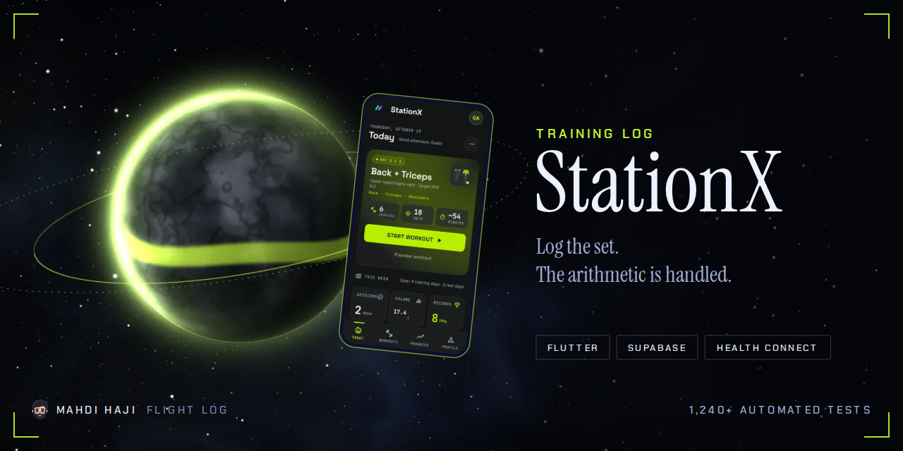
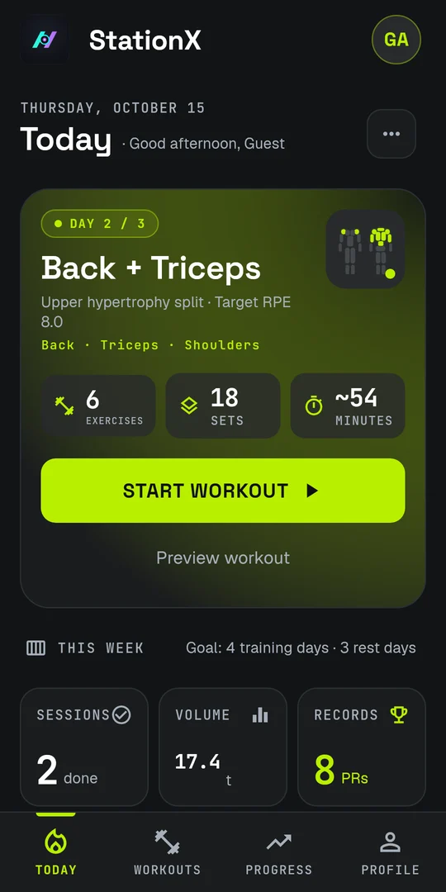
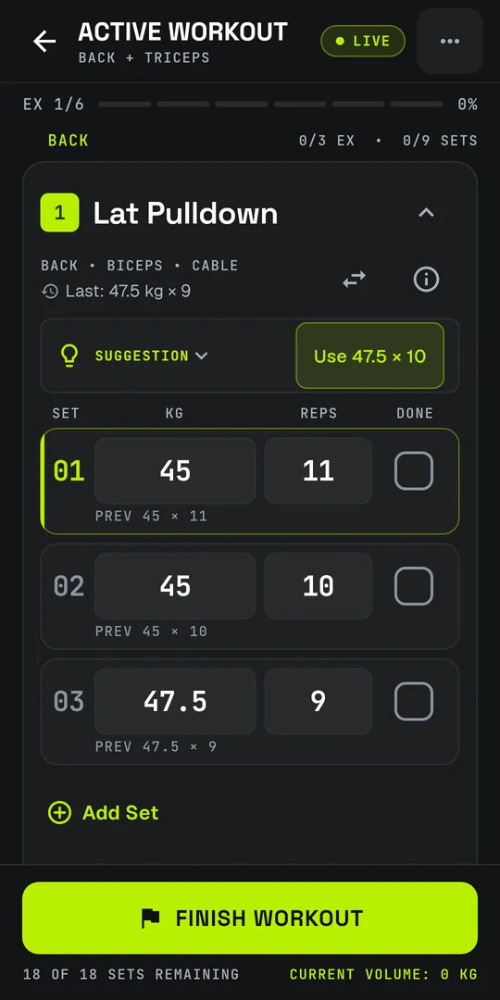
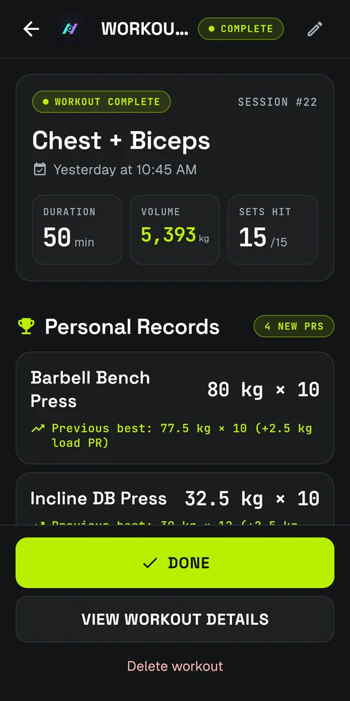
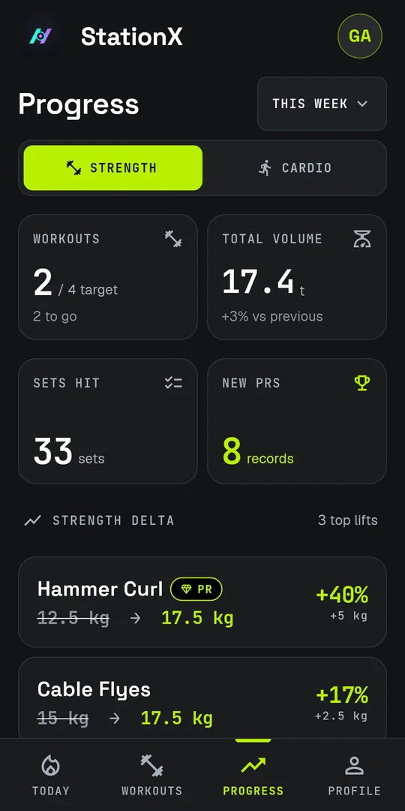
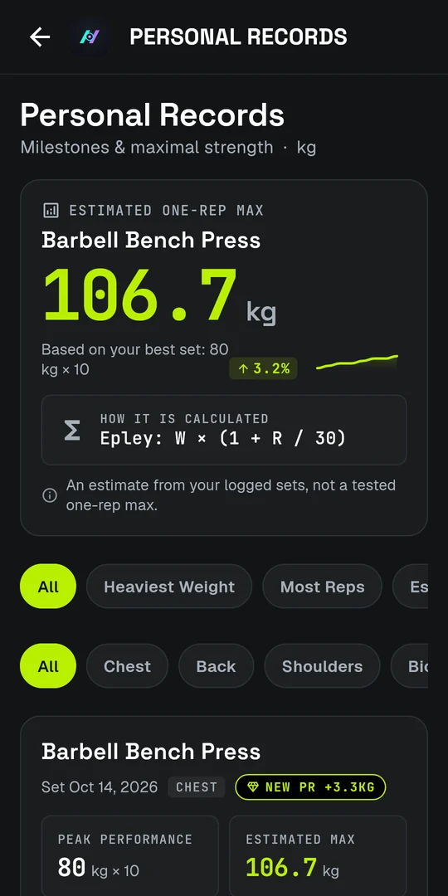
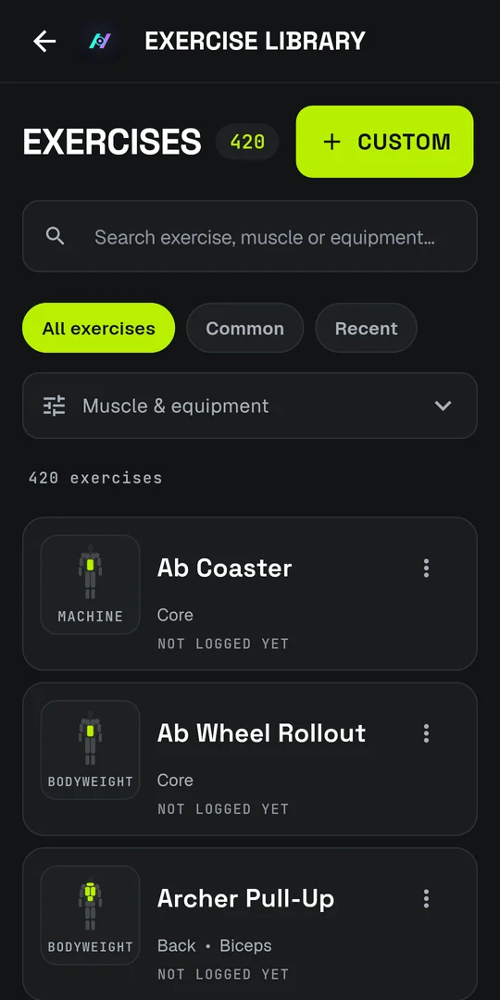
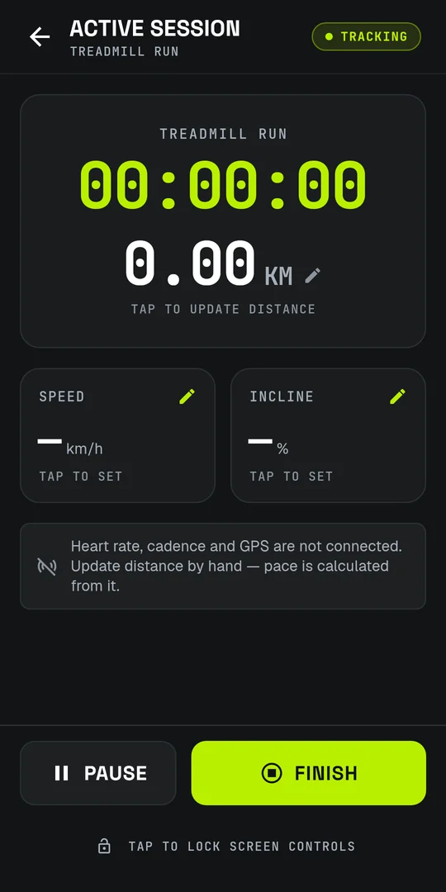
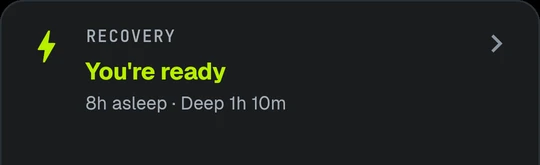
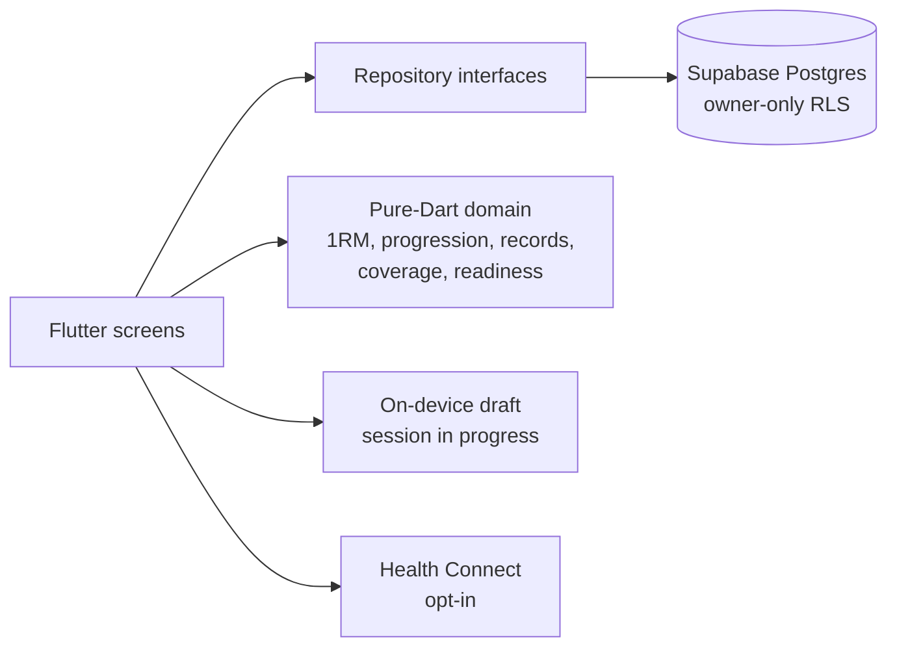

# StationX

Log the set. The arithmetic is handled. A strength and cardio tracker for Android that builds your program once, keeps your rotation in order, and works out estimated one-rep max, volume, records and what to lift next.

`Flutter` `Supabase` `Health Connect` `Android`

> [!NOTE]
> 🔒 **The source code is private.** This repo shows the product. A live demo or a code walkthrough is available on request: [email](mailto:mahdemghr2003@gmail.com) or [LinkedIn](https://www.linkedin.com/in/mahdi-mohamed-875120317).
> Interactive case study: **[mahdi-haji.dev/stationx.html](https://mahdi-haji.dev/stationx.html)** · [Privacy policy](https://mahdi-haji.dev/stationx-privacy.html)

## Screens

<table>
<tr>
<td align="center" width="25%"> Today</td>
<td align="center" width="25%"> Logging a session</td>
<td align="center" width="25%"> Summary and records</td>
<td align="center" width="25%"> Progress</td>
</tr>
<tr>
<td align="center"> Personal records</td>
<td align="center"> 420-exercise library</td>
<td align="center"> Cardio</td>
<td align="center"> Readiness (opt-in)</td>
</tr>
</table>

Real app screens, rendered with demo data. Sleep data shown is made up.

## What it does

- **Builds your program once.** A short setup (split, equipment, experience) generates it, and nothing changes it unless you ask.
- **The rotation waits for you.** It moves only when you finish a workout, so a sick week or a holiday changes nothing.
- **A logger built for sweaty thumbs:** last time's numbers beside every set, a one-tap suggestion, a keypad, a plate calculator, and drafts saved on every change, so a crash loses nothing.
- **Smart Swap** ranks replacement exercises by muscle, movement pattern, equipment and your own history.
- **420 exercises with a real muscle model**, and 33 cardio activities that each show the right pace (per km, per 500 m, per 100 m).
- **Progress that compares fairly** (a Wednesday against a Wednesday), with estimated 1RM, records per exercise and a training calendar.
- **Health Connect, opt-in:** save workouts, import watch workouts, see heart rate, and get a push-or-ease-off readiness verdict from sleep and resting heart rate.
- **Private by default:** no analytics, ads or tracking. Sign-in uses a username, and no email is collected.

## How it's built

- About 58k lines of Dart in 231 files, with **1,240+ automated tests** across 98 files.
- The maths stays out of widgets: a pure-Dart domain layer with no Flutter and no I/O.
- An in-memory fake of Supabase with per-user isolation and failure injection drives tests for sign-up, account switching, double submits, expired sessions and stale replies.

## Decisions I'd defend

- **Online-first, on purpose.** StationX began offline and was rebuilt around an account. The screen never says "saved" before the server has.
- **Atomic changes.** Finishing a workout and moving the rotation is one database function, and retries can't duplicate anything.
- **Hard to misconfigure.** The build refuses a non-HTTPS address or any key that carries the service role, and a release build fails without a signing key.
- **Removed on purpose:** the rest timer and stopwatch were built and then cut. The logger records what you lifted and leaves the clock to you.

## Status

A personal project by Mahdi Haji, Android first. Its offline companion app is the public [Gym Tracker](https://github.com/mahdawemghr/gym_tracker), and StationX can import its exports.

Not done yet:
- The release build hasn't been tested on a real phone over a flaky network or after a long idle sign-in.
- iOS has never been built, so the Apple Health code hasn't run.
- There is no offline mode: logging in and saving need a connection.

## Contact

[mahdi-haji.dev](https://mahdi-haji.dev) · [LinkedIn](https://www.linkedin.com/in/mahdi-mohamed-875120317) · [Email](mailto:mahdemghr2003@gmail.com) · [All projects](https://github.com/mahdawemghr)

© 2026 Mahdi Haji. All rights reserved.
